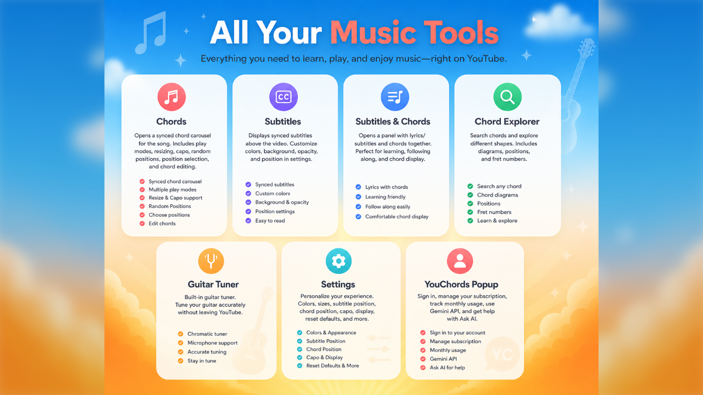
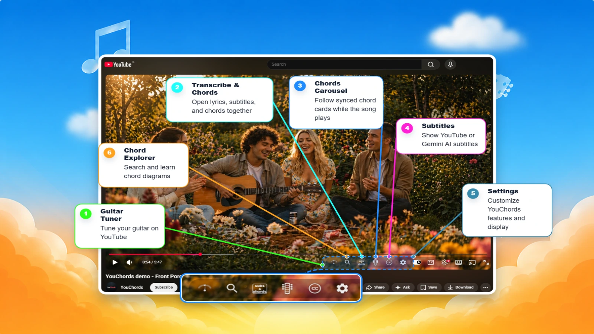
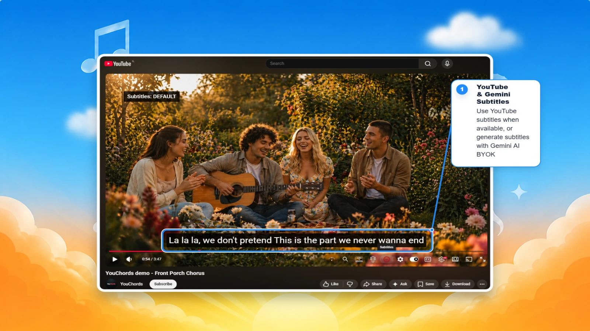
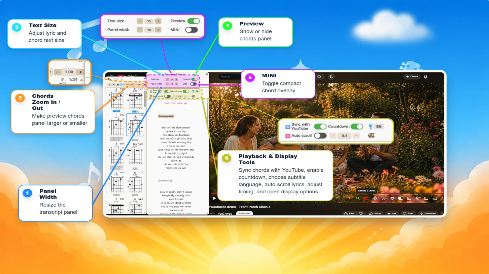
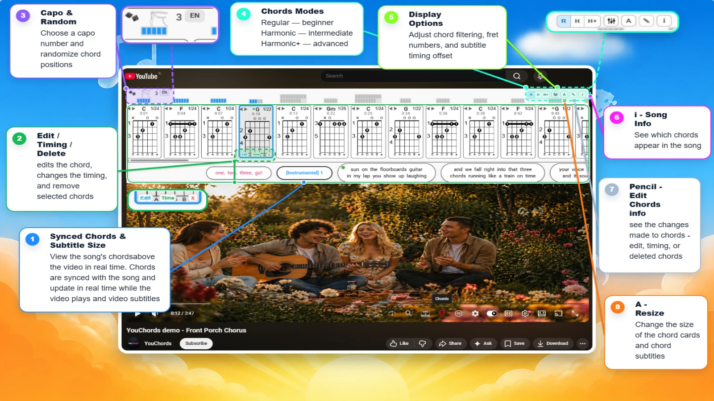
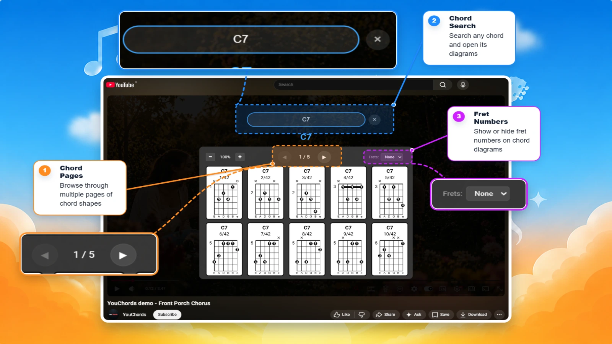
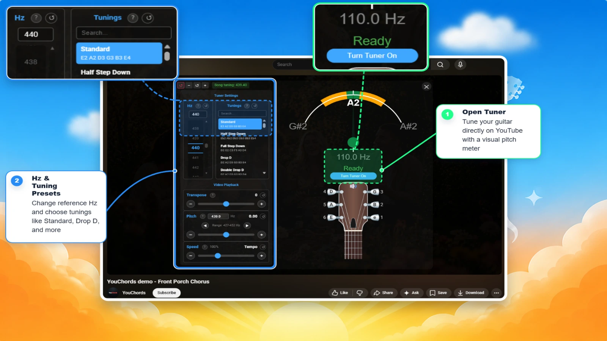
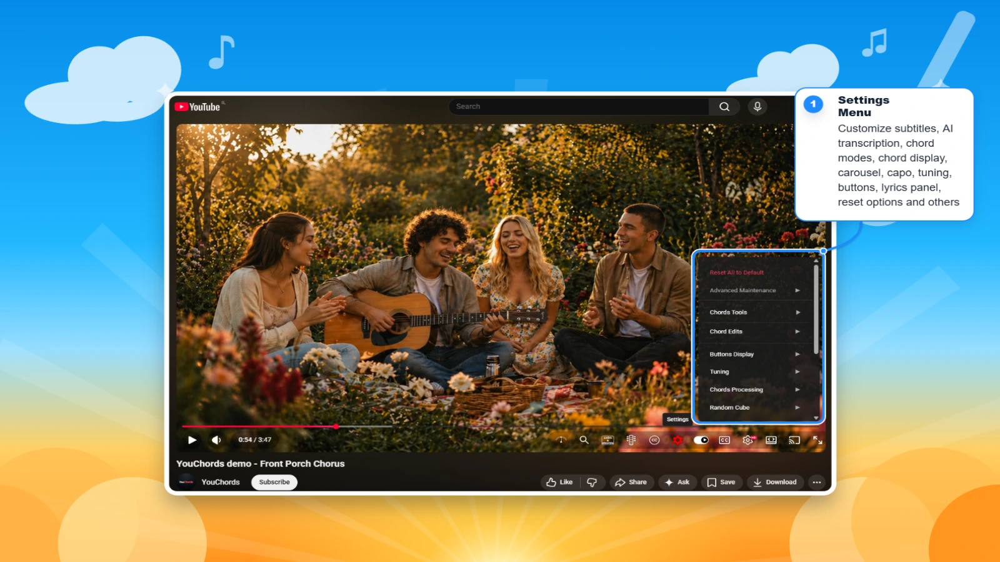
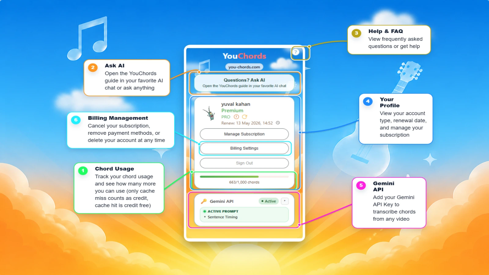
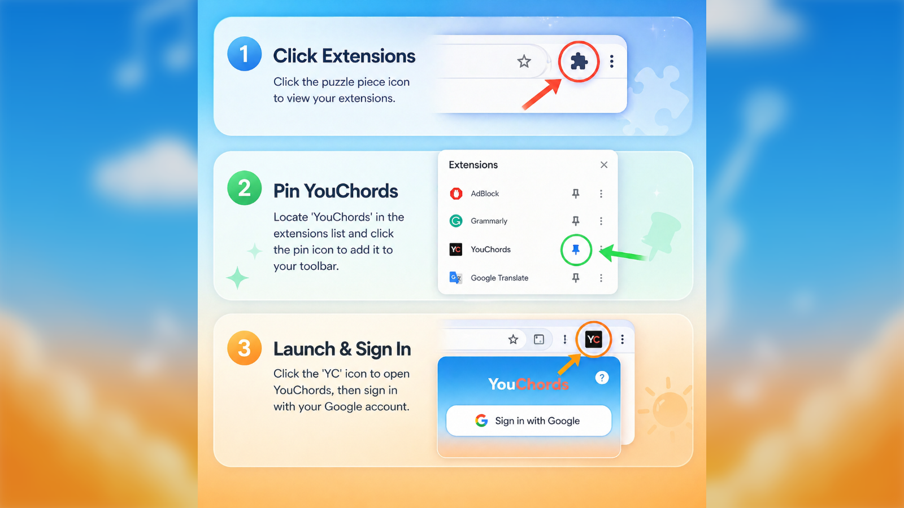

<p align="center">
  
</p>

<h1 align="center">YouChords Local</h1>

<p align="center">
  A local-first Chrome extension that adds synchronized chords, lyrics, word-level transcription, audio tools, and guitar practice controls to YouTube.
</p>

# ⚠️ CRITICAL — keep `yt-dlp` updated to the latest release

**YouChords depends on `yt-dlp` to download a video's audio. YouTube changes frequently; an outdated `yt-dlp` is the most common reason processing suddenly stops working. Update it before troubleshooting anything else, and keep it current.**

From the repository root, rebuild the local processor without Docker's package cache so it installs the newest version allowed by `requirements.local.txt`:

```powershell
docker compose -f docker-compose.local.yml build --no-cache youchords-local
docker compose -f docker-compose.local.yml up -d
docker compose -f docker-compose.local.yml exec youchords-local yt-dlp --version
```

If YouTube downloads fail, do this first. Do not assume a previously working `yt-dlp` build is still current.

---

## What it does

YouChords turns a YouTube music video into a practice workspace without sending its processing jobs to a hosted backend:

- Detects and displays synchronized chord diagrams.
- Shows subtitles and chords together in a focused practice panel.
- Creates local WhisperX transcripts with sentence and word timestamps.
- Lets you choose **Whisper large-v2** or **Whisper large-v3** in **Chords → Subtitles In Chords**.
- Uses the GPU for WhisperX inference when Docker has GPU access; an RTX 4090 is an excellent fit.
- Stores chord and transcription results locally, so returning to the same video/model/language can reuse the cache.
- Adds audio separation, tuner, chord explorer, transposition, capo, pitch/speed controls, and jam-session tools.

## See it in action

<table>
  <tr>
    <td width="50%"></td>
    <td width="50%"></td>
  </tr>
  <tr>
    <td align="center"><strong>Music tools in the player</strong></td>
    <td align="center"><strong>Controls beside YouTube playback</strong></td>
  </tr>
  <tr>
    <td width="50%"></td>
    <td width="50%"></td>
  </tr>
  <tr>
    <td align="center"><strong>Synced subtitles</strong></td>
    <td align="center"><strong>Subtitles and chords panel</strong></td>
  </tr>
  <tr>
    <td width="50%"></td>
    <td width="50%"></td>
  </tr>
  <tr>
    <td align="center"><strong>Follow chord changes in time</strong></td>
    <td align="center"><strong>Explore chord shapes</strong></td>
  </tr>
  <tr>
    <td width="50%"></td>
    <td width="50%"></td>
  </tr>
  <tr>
    <td align="center"><strong>Built-in tuner</strong></td>
    <td align="center"><strong>Personalized settings</strong></td>
  </tr>
  <tr>
    <td width="50%"></td>
    <td width="50%"></td>
  </tr>
  <tr>
    <td align="center"><strong>Profile and preferences</strong></td>
    <td align="center"><strong>Extension popup</strong></td>
  </tr>
</table>

## Quick start on Windows

### 1. Prerequisites

- Google Chrome or another Chromium browser.
- Docker Desktop with its WSL 2 backend running.
- An NVIDIA GPU with Docker GPU support. The included compose file requests `gpus: all` for Whisper transcription and audio separation.
- The first processor build downloads Python dependencies and AI models, so it can take a while and needs a reliable internet connection.

### 2. Start the local processor

```powershell
.\scripts\start_youchords_local.ps1
```

Check that it is ready:

```powershell
Invoke-RestMethod http://127.0.0.1:8765/v1/health
```

The endpoint should respond with the processor health status. The configured transcription engine is `whisperx` and it uses CUDA when Docker can access your NVIDIA GPU.

### 3. Load the extension in Chrome

Open `chrome://extensions`, enable **Developer mode**, choose **Load unpacked**, and select the repository folder containing `manifest.json`.

Open a YouTube music video and use the YouChords buttons next to the player controls.

## Whisper subtitles: v2 or v3

Open **Chords → Settings → Subtitles In Chords → Whisper Model** and select one of these options:

| Model | Best use | Notes |
| --- | --- | --- |
| `large-v2` | Default, excellent quality | The current default and a very strong balance of speed and accuracy. |
| `large-v3` | Maximum transcription quality | Usually more accurate, particularly on difficult audio; its first use may download the model and can take longer. |

Both choices use the same local **WhisperX** workflow. WhisperX creates word-level timing through forced alignment, so a sentence can be highlighted while the active word is highlighted inside it. The selected model, language, and transcript are tracked independently: selecting another model intentionally creates a fresh transcript instead of silently reusing the one from the other model.

## Local processing and cache

The local companion service runs at `http://127.0.0.1:8765` and handles the expensive tasks in a FIFO queue. This prevents Whisper, chord extraction, and audio separation from fighting for the GPU on long videos.

- **WhisperX models and aligners** are downloaded once into `.youchords-local/models` and `.youchords-local/huggingface`.
- **Finished transcripts** are cached by video ID, Whisper model, and requested language under `.youchords-local/output`.
- **Browser-side subtitle and chord data** is saved in IndexedDB, so reopening the same video normally reuses the result.
- If you switch from `large-v2` to `large-v3` (or change the language), a new transcript is expected and correct.

## Troubleshooting

### The local extension says the processor is unavailable

```powershell
docker compose -f docker-compose.local.yml ps
docker compose -f docker-compose.local.yml logs -f youchords-local
```

Then check the health endpoint again.

### Downloads or long-video processing fail

Start with the **critical `yt-dlp` update** at the top of this README. After the rebuild, retry the job. For long videos, leave the page open while the local queue finishes its earlier jobs.

### Whisper does not use the GPU

Run the health check. If it does not say `device: cuda`, make sure Docker Desktop can access the NVIDIA GPU, then restart the processor:

```powershell
docker compose -f docker-compose.local.yml down
docker compose -f docker-compose.local.yml up --build -d
```

## Security

This repository must never contain API keys, passwords, private keys, browser tokens, or local `.env` files. Keep credentials in local ignored configuration only, rotate anything that was ever exposed, and review `git status` before committing.

## Development notes

- The local companion source is in [`chord-extractor-clean`](chord-extractor-clean).
- The browser extension source is at the repository root.
- Load the repository root as an unpacked extension; generated builds, local caches, and model files are intentionally not committed.
- Gemini subtitles and translations are optional cloud features. They use a key you provide in the extension settings; no API key is included in this repository.
